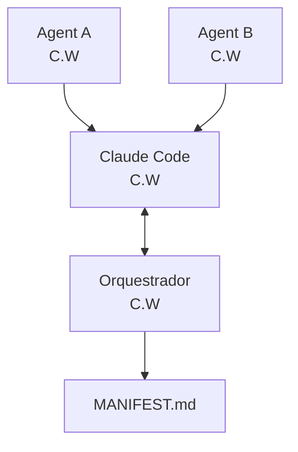
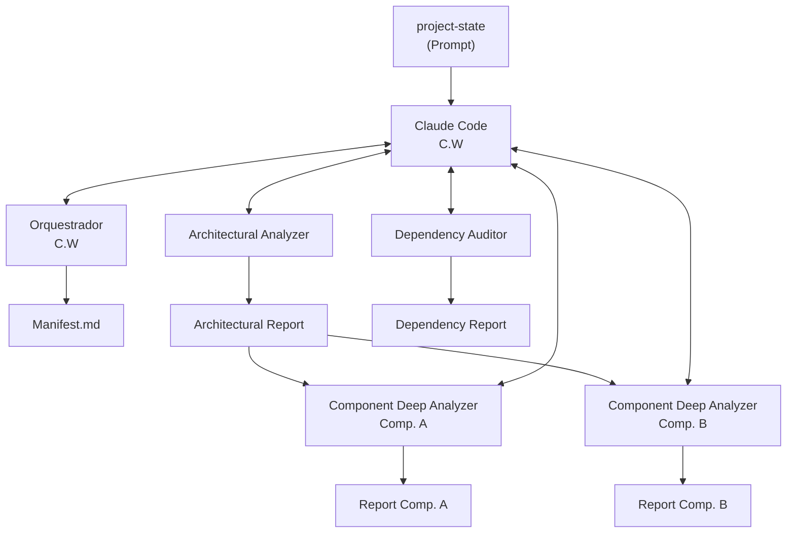

# Anatomia: Workflow Spec vs Role Spec

## Estruturados com resultados específicos (Especialistas)

- Persona e Escopo
- Objetivo
- Entradas
- Saídas
- Critérios de qualidade
- Tratamento de ambiguidades e "assumptions"
- Instruções negativas
- Tratamento de erros
- workflow (opcional)

## Workflow Specification Prompt (Commands)

- Description
- Output template
- Critical Constraints
- Execution Workflow
- Usage Examples
- Negative instructions

## Role Specification (Orquestrador)

- Role Definition
- Core Responsibilities
- Operational Framework
- Decision-Making Principles
- Communication Standards

## Prompts como Sub-agentes (Claude Code)

- Claude Code tem a sua Context Window (C.W); cada Agent (A, B, ...) tem a sua própria C.W.
- Claude Code **NÃO** possui acesso à C.W dos Agents e vice-versa.
- Eles se comunicam por input e output da chamada.
- Um Command (prompt) pode solicitar qualquer coisa ao Claude, inclusive a invocação de agentes.
- Agentes podem ser executados em paralelo!

## Orquestradores e gerenciamento de estado

- Janela de contexto é limitada
- Processos podem ser interrompidos por diversos motivos

Como cada agente não possui acesso à Janela de Contexto do outro, a utilização de um agente "orquestrador" se faz útil, pois ele mantém o tracking do workflow.

Orquestrador tem que ser capaz de se adaptar a "qualquer" workflow.

## Exemplo: project-state

**Step 1:**
- Setup de folders dos agentes
- MANIFEST

**Step 2:**
- Execução paralela (Architectural Analyzer + [Dependency Auditor](dependency-auditor.md))
- Output: Reports

**Step 3:**
- Input: Arch Report
- Output: Reports para cada componente
- Execução paralela

> Presumido (cortado na print): nomes "Dependency Report" / "Architectural Report" e os reports de saída de cada Component Deep Analyzer.
