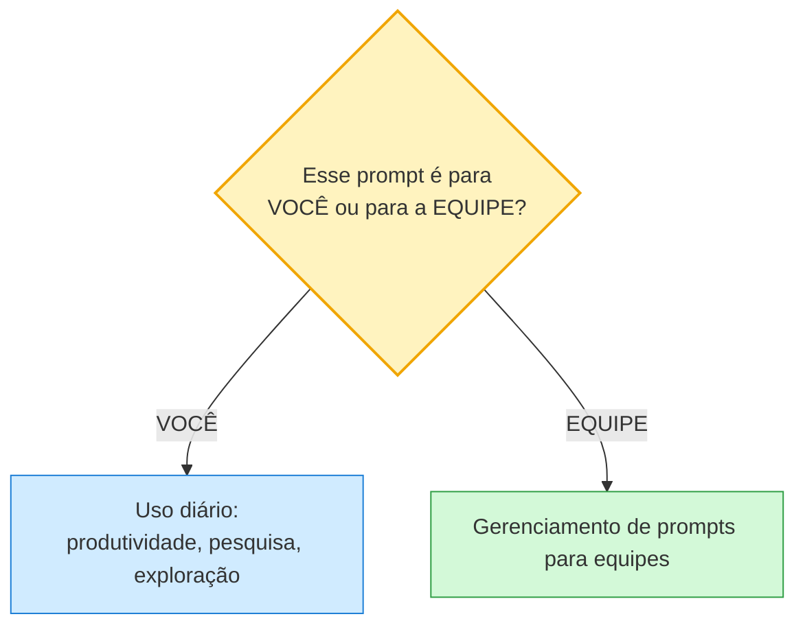
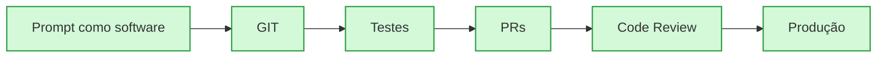
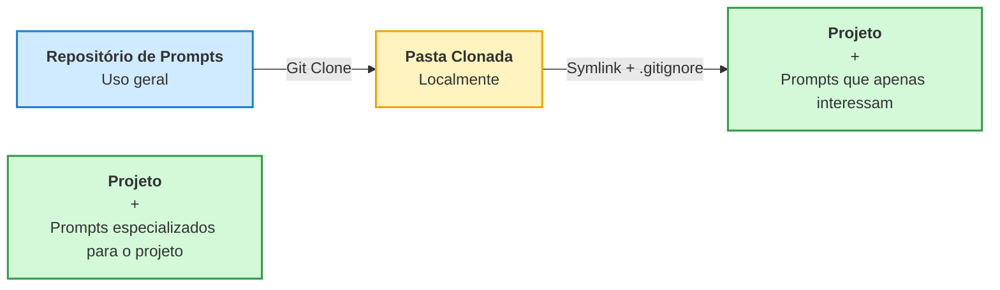

# Versionamento de prompts

## Prompts para utilização diária (foco em produtividade, pesquisa, exploração)

**Defina se o prompt é para VOCÊ ou para sua EQUIPE.**

### Gerenciamento de prompts para equipes

Entenda prompt como software — portanto, aplique o mesmo ciclo de vida:

### Fluxo de distribuição dos prompts

> O box **Projeto + Prompts especializados para o projeto** aparece solto no quadro: são os prompts que nascem e vivem dentro do repositório do próprio projeto, sem passar pelo repositório geral.

### Notas sobre o fluxo

- **Repositório de Prompts: Uso geral** — prompts reutilizáveis, versionados em Git.
- **Git Clone** — cada pessoa clona o repositório para uma pasta local.
- **Pasta Clonada Localmente** — cópia local de todos os prompts gerais.
- **Symlink + .gitignore** — dentro do projeto, cria-se link simbólico apenas para os prompts relevantes, e o `.gitignore` evita versioná-los junto ao projeto.
- **Projeto + Prompts que apenas interessam** — o projeto enxerga só o subconjunto de prompts gerais que faz sentido para ele.
- **Projeto + Prompts especializados para o projeto** — prompts específicos do projeto ficam versionados no próprio repositório do projeto.

### Estrutura:

#### README

- Índice categorizado

#### Doc de cada prompt

- Verificação de vulnerabilidades - Doc.md
-- Nome do Prompt
-- Link para o prompt plain
-- Objetivo
-- Modelos testados / utilizados
-- Observações gerais
-- Últimas atualizações

#### Categorização

- Exploração e Planejamento (Analisar code base, segurança, guidelines, projetar novas features)
- Documentação (Criação e manutenção de Design Docs)
- Implementação (Workflow de desenvolvimento, testes automatizados, correção de bugs, refatoração, LLM-as-a-Judge)
- Especialização (Desenvolver em GO, Spring, Laravel, Langgraph)
- Infra (Dockerfile, docker-compose, k8s, terraform, ci/cd)
- Utils (Commits, PR, Code Review)

### Prompts para desenvolvimento de aplicações / agentes:

**Lógica básica:**
- Registry (Contém todos os prompts e suas versões a serem utilizadas)
- Identificar por Agente, Caso de uso, Componente, subdomínio
- SemVer (semantical versioning v1.1.0)
- Arquivo do Prompt
- Metadados (podem estar no próprio artquivo) do prompt
- Casos de teste para validar a compilação do prompt
- README.md - Contexto do prompt e onde ele é utilizado e breve change log 