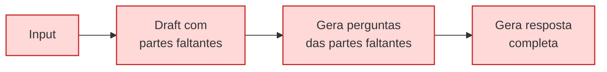

# Query reformulation / Prompt Enrichment

Técnica em que a consulta original do usuário é reescrita — automaticamente ou por uma
camada intermediária — antes de chegar ao modelo. O objetivo é transformar um pedido
curto, vago ou sem contexto em uma instrução completa e acionável.

## Necessidades para reformulação e enriquecimento de prompts

### Consulta do usuário é vaga ou ambígua

- Prompts curtos ou com baixa clareza.

```text
<user>: Python em LangChain
<reformulação>: Crie um guia completo explicando como trabalhar com LangChain
                com Python do básico ao avançado.
```

### Falta de contexto relevante

- Usuário não adiciona no prompt informações / contexto importantes para o modelo
  responder de forma assertiva.

```text
<user>: Como criar uma API em Python?
<reformulação>: Explique como desenvolver um CRUD com Golang e disponibilizar
                endpoints REST utilizando o framework Go.
```

### Alinhamento de formatos

- Se há a necessidade de que a resposta tenha uma saída explícita seguindo um
  determinado padrão.

```text
<user>: Explique as regras de negócio desse sistema.
<reformulação>: Faça um resumo das regras de negócio módulo a módulo desse sistema
                e retorne o resultado utilizando Markdown no formato:
                # Regras de negócio, ## Regra X, Conteúdo do resumo
```

### Minimizar riscos de respostas incorretas

- Uma pergunta pode induzir a IA a gerar respostas com alucinações ou incompletas.

```text
<user>: Quem criou a linguagem Python em 2012?
<reformulação>: Quem foi o criador da linguagem Python e em que ano ela foi lançada?
```

### Realizações de buscas semânticas

- Ter a possibilidade de enriquecer com a mais detalhes, corrigindo erros de
  ortografia, expandir sinônimos.

```text
<user>: Esse código está "serto" em go?
<reformulação>: Revise o seguinte código na linguagem Go e identifique possíveis bugs,
                problemas de performance. Forneça sugestões de melhorias com exemplos.
```

### Personalização

- Quando há conhecimento do contexto, perfil, público e detalhes importantes que
  possam ajudar no resultado da pergunta.

```text
<user>: Explique como desenvolver aplicações com IA e Python.
<reformulação>: Explique como desenvolver aplicações com Python para quem nunca teve
                contato com a linguagem. Adicione o comparativo com Typescript.
```

## Principais técnicas

### Query2Doc

- Geração um "documento" que explica o que a consulta realmente quer.
- Utilização do texto gerado para expandir a query antes executar.

Passo a passo:

- Recebe query curta do usuário
- Prompt few-shot para o LLM pedindo um "mini-documento" bem objetivo sobre o tema da query
- Concatena esse documento com a query original
- Realiza a busca léxica (BM25 / Elastic)
- Retorna os trechos recuperados
- Gera resposta final

### Hyde (Hypotetical Document Embeddings)

- Geração um "documento" com a intenção de ser a resposta final.
- Utilização do documento para fazer busca.

Passo a passo:

- Recebe query curta do usuário
- Prompt para gerar documento
- Concatena esse doc com a query original
- Gera embeddings
- Realiza busca semântica
- Retorna os trechos recuperados
- Gera resposta final

### Query2Doc vs HyDE

- Query2Doc pede um mini-artigo explicativo/neutro (para enriquecer o vocabulário)
- HyDE pede um documento que parece a resposta real (para capturar a semântica e
  contexto relevante)

- Query2Doc nasceu focada para quem já utiliza BM25/Elastic e quer enriquecer as queries
- HyDE nasceu para quem já usa bancos vetoriais e precisa melhorar o
  "dense retrieval zero-shot"

- São similares mas o estilo de texto que você pede ao LLM é diferença:
  - Query2Doc precisa de descrição neutra
  - HyDE que resposta hipotética.

#### Prompt para Query2Doc

```text
Escreva um texto informativo e neutro, de 100 a 150 palavras,
que explique o tópico abaixo. Inclua definições, termos técnicos,
sinônimos e contexto relacionado, mas não dê uma resposta direta
se for uma pergunta.

Tópico: "{query}"
```

#### Prompt para HyDE

```text
Escreva um parágrafo conciso que responda de forma clara
à pergunta abaixo. A resposta deve parecer um documento real,
com datas, fatos ou descrições prováveis, mesmo que hipotéticas.
Não use linguagem especulativa (não diga "talvez" ou "possivelmente").

Pergunta: "{query}"
```

### ITER-RETGEN

- Loop iterativo que alterna entre geração e recuperação.
- Gera rascunhos e depois usa o rascunho para buscar de forma mais específica.

Passo a passo:

- Gere um rascunho com "missing markers".
- Transforma lacunas em buscas
- Busca informações relevantes
- Reescreve a resposta e verifica se há mais lacunas ou possibilidade de expansão

Exemplo:

- Draft
- Query
- Fill
- Expansion (Caso tenhamos poucas iterações, expandimos para mais perguntas)


